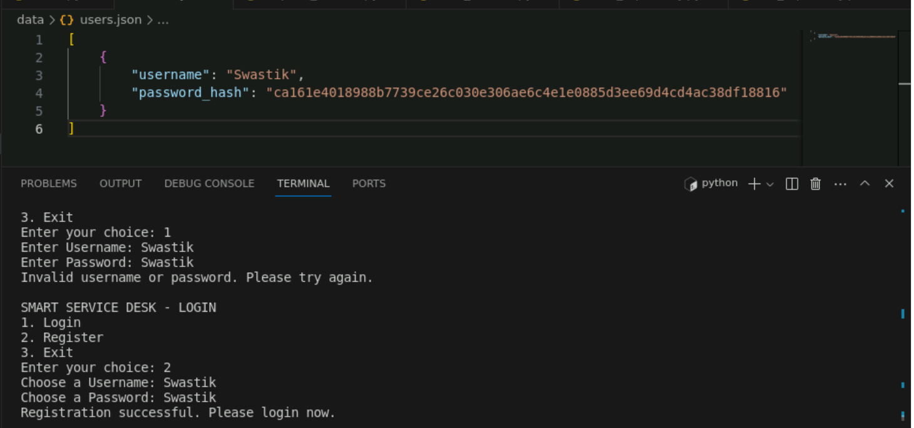
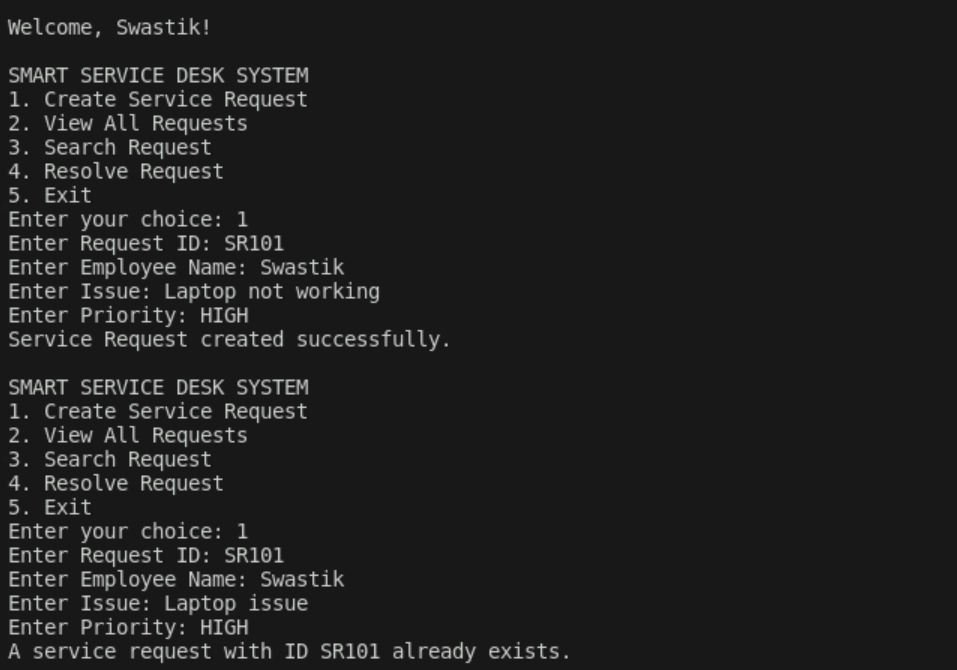
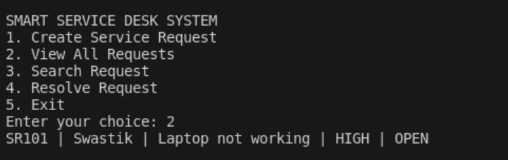
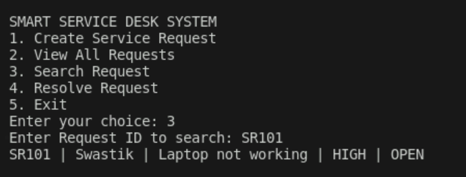
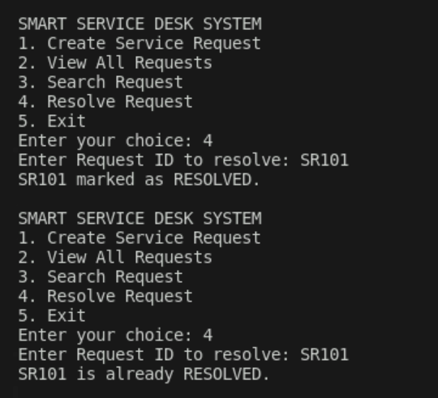
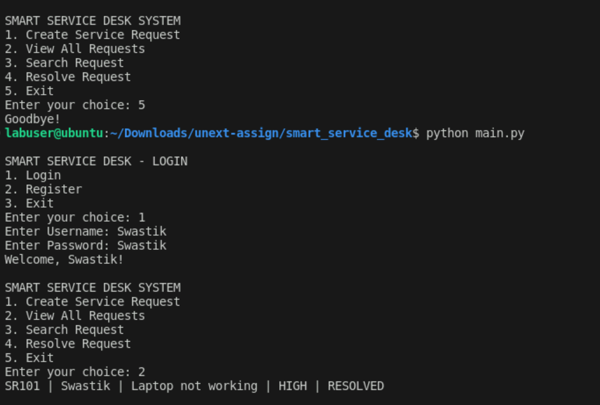
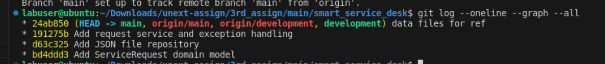

# Smart Service Desk Management System
**Author:** Swastik Ravindra Shenvi

## Problem Statement
A company receives IT support requests from employees for laptop, software, network, password, account and access related issues. These were tracked manually. This application gives support staff a simple, login-protected CLI tool to create, view, search and resolve service requests, with all data kept safe in JSON files between runs.

## Features Implemented
- Register and login before the main menu is shown.Along with password Hashing and credentials verification.For e.g. User needs to be registered first to log in



- Create a service request (status is always set to OPEN automatically)
- Block duplicate Request IDs with a friendly message
  
  
- View all saved service requests


- Search a request by Request ID
  
  
- Resolve an OPEN request; show a message if it is already RESOLVED
 

- Full persistence: requests and users reload correctly after restart


## Concepts Used
- OOP: ServiceRequest and User classes with constructors, attributes, and methods (resolve(), check_password())
- Exception Handling: custom exceptions (RequestNotFoundError, DuplicateRequestError, InvalidPriorityError, InvalidCredentialsError, UserAlreadyExistsError), no bare except
- File Handling: JSON persistence through the os and json modules in the infrastructure layer
- SOLID: Single Responsibility (each class/module has one job) and Dependency Inversion (services depend on repository objects passed into them, not on file details)
- DDD: domain / application / infrastructure layers kept strictly separate
- Git: development branch for building features, merged into main after testing

## Architecture

The project is split into layers so every file only does one job:

- **Domain layer** — `ServiceRequest` and `User` hold only data and business rules (like what happens when a request is resolved). They never read or write files.
- **Application layer** — `RequestService` and `AuthService` contain the actual use cases (create, view, search, resolve, login, register). They call the domain and infrastructure layers but never touch files directly.
- **Infrastructure layer** — `FileRepository` and `UserRepository` are the only two files in the entire project that open or write JSON.
- **Presentation layer** — `main.py` only prints menus, takes input and calls the application layer.

## Custom Exceptions

Instead of letting the program crash, these situations raise a specific exception that `main.py` catches and turns into a friendly message:

| Exception | When it happens |
|---|---|
| `DuplicateRequestError` | Creating a request with an ID that already exists |
| `RequestNotFoundError` | Searching for ID that doesn't exist |
| `InvalidPriorityError` | Giving a request a priority other than LOW, MEDIUM or HIGH |
| `InvalidCredentialsError` | Logging in with the wrong username or password |
| `UserAlreadyExistsError` | Registering a username that is already taken |

## Project Folder Structure
```
smart-service-desk/
├── domain/
│   ├── service_request.py
│   ├── users.py
│   └── exceptions.py
├── application/
│   ├── request_service.py
│   └── auth_service.py
├── infrastructure/
│   ├── file_repository.py
│   └── user_repository.py
├── data/
│   ├── requests.json
│   └── users.json
├── main.py
├── README.md
└── .gitignore
```

## How to Run
```
python main.py
```
Register a username and password the first time the app runs, then log in on every run after that. Once logged in, use the numbered menu to create, view, search and resolve requests.


## Branching and Merge Workflow
All feature work was committed step by step on the development branch (domain model, repository, services, auth, CLI). After manually testing the full flow — create, duplicate check, view, search, resolve, restart, persistence check — development was merged into main:


### Development Branch and Feature Commits

All feature work was committed step by step on the `development` branch, starting with the domain model and ending with the login and authentication feature, so that each layer of the application (domain, repository, services, auth, CLI) has its own clear history entry.

```bash
git checkout -b development

git add domain/
git commit -m "Add ServiceRequest domain model"

git add infrastructure/
git commit -m "Add JSON file repository"

git add application/
git commit -m "Add request service and exception handling"

git add main.py README.md .gitignore
git commit -m "Complete CLI application"

git add application/auth_service.py domain/users.py infrastructure/user_repository.py data/users.json
git commit -m "Add login and authentication functionality"
```

### Branching and Merge Workflow

With `development` fully tested, the `main`  was created and the verified work was merged into it, giving a clean final branch for submission while preserving the complete development history.

```bash
git checkout -b main
git merge development
git push -u origin main
```
main always holds the last known-working,ready version, while development was used for incremental, in-progress work.

### Verifying the Workflow

To confirm all commits, branches and the merge were correctly reflected, the commit graph was checked before submission.
(4th commit was "data files for reference along with Complete CLI application ' )

```bash
git log --oneline --graph --all
```


## Mandatory Demonstration:
Login/Register Functionality with Password Hashing


Create SR101 with priority HIGH and Try to create SR101 again and show duplicate handling


View all requests


Search for SR101
  
  
Resolve SR101 and Try to resolve SR101 again


Exit and restart the application and Search SR101 and prove that RESOLVED status was saved

